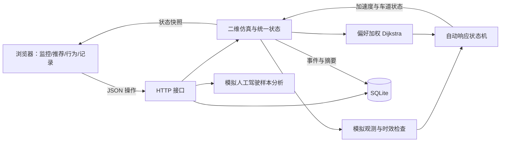
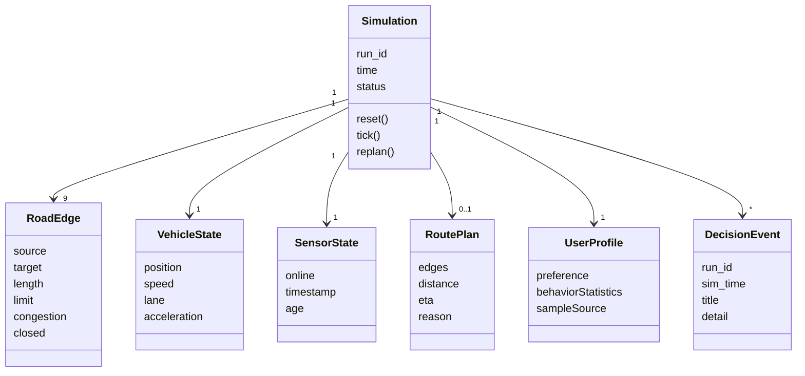
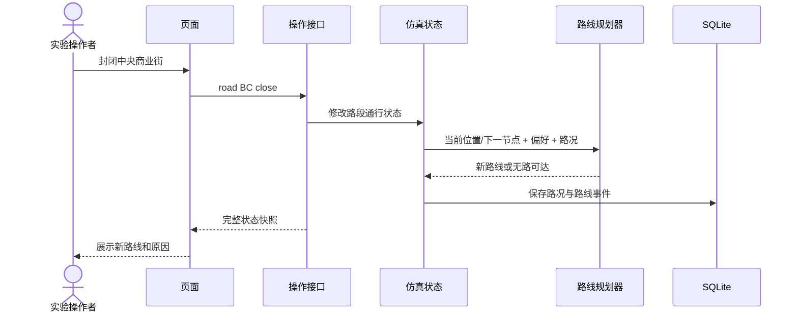
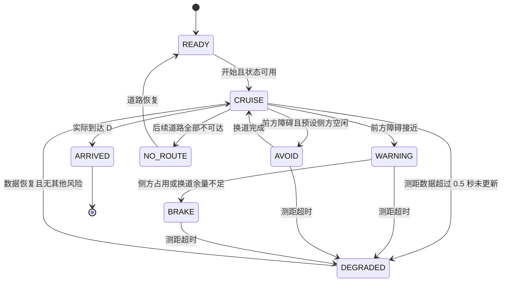

# 智能驾驶集成系统：分析与设计初稿

本文件与当前代码对应，可作为课程报告素材。交付前应按教师模板补充成员、需求来源、图号和实验结果。

## 1. 目标与系统边界

目标：在可重复的简化场景中展示“传感器观测—路况与偏好分析—路线推荐—自动响应—事件记录”的完整流程。

参与者：驾驶用户（设置偏好、查看建议）、实验操作者（启动场景、注入故障）、评测人员（检查日志和测试结果）。当前软件通过同一界面提供这些操作，没有实现账号或权限系统。

外部依赖：Python 运行时、浏览器、本地文件系统。SUMO 是已准备场景导出的可选外部仿真器，尚未加入网页控制闭环。

空间范围：8 个节点、9 条有向路段，每段用双车道示意。起点固定 A，终点固定 D。正常场景控制一辆车；急停场景增加一个静止障碍，侧方占用由场景参数设定。

## 2. 需求与追踪

| 编号 | 需求 | 实现位置 | 验收依据 |
|---|---|---|---|
| FR-01 | 显示位置、车速、前车距离及数据时效 | simulation.py / app.js | 运行时更新，暂停时仿真时间不变 |
| FR-02 | 注入拥堵、封路和恢复事件 | set_road / replan | 封闭路段不进入候选路径，恢复后可继续 |
| FR-03 | 三种偏好产生可解释的路线 | network.py | 正常路网分别选择中央、北侧和南侧路线 |
| FR-04 | 途中改道保持物理位置 | replan | 修改后坐标不瞬移 |
| FR-05 | 统计模拟人工驾驶行为 | behavior.py | 相同种子结果一致，样本来源明确 |
| FR-06 | 前车急停且侧方占用时制动 | tick | 本预设场景中速度降为零、未碰撞、未换道 |
| FR-07 | 预设侧方空闲时避让 | tick | 减速后换道完成并继续行驶 |
| FR-08 | 测距超时降级，恢复后可继续 | set_sensor / tick | 超过 0.5 仿真秒后降级，恢复后重新巡航 |
| FR-09 | 无可行路线时停止且不误报到达 | replan / tick | 无路状态明确，恢复通路后可达终点 |
| FR-10 | 保存实验摘要与决策事件 | storage.py | 数据库重开后记录仍存在，可导出 CSV |

非功能性设计目标：单机运行、启动步骤少、无外部前端资源、可重复实验、单位一致、界面展示决策依据。当前 0.1 秒仿真步长和约 250 ms 页面轮询是实现参数，不代表已验证的硬实时响应上限。

## 3. 软件架构



实现采用模块化单体。一个锁保护共享仿真状态，避免 HTTP 操作和仿真线程交叉修改。当前响应策略与车辆推进集中在 `simulation.py` 中，是后续优先拆分的部分。

## 4. 核心领域对象



这是领域模型，不意味着所有对象均已封装为 Python 类。当前部分对象以字典表达，例如路段和路线；报告应区分领域概念与代码结构。

## 5. 用户行为模型

输入：固定随机种子生成的 120 个 1 秒采样点，包含加速度和跟车时距。三类样本为平稳、频繁加减速、谨慎。

规则：加速度大于 2.5 m/s² 记为急加速采样点；小于 -2.5 m/s² 记为急刹车采样点；时距小于 1.2 s 记为短时距采样点。

评分为 `max(0, 100 - 急加速点数 - 急刹车点数 - 短时距点数)`。大于等于 80 分显示平稳倾向，否则提示关注。规则和阈值均为教学设定，未经真实驾驶人群验证。

导航偏好由用户显式选择。行为统计不自动放宽安全约束，也不使用自动控制器输出推断真实用户驾驶风格。下一阶段可导入人工驾驶 CSV，并将连续异常采样合并成事件。

## 6. 路径推荐模型

有向图上使用 Dijkstra。封闭边直接排除，其余代价非负：

```text
cost(e) = w_time × length / limit × congestion / 100
        + w_distance × length / 1000
        + w_comfort × difficulty × length / 1000
```

| 偏好 | 时间权重 | 距离权重 | 舒适权重 |
|---|---:|---:|---:|
| 距离优先 balanced | 0.20 | 0.70 | 0.10 |
| 时间优先 fast | 0.90 | 0.05 | 0.05 |
| 舒适优先 comfort | 0.05 | 0.05 | 0.90 |

100 s 和 1000 m 是固定标度，不是样本最大值归一化。路段复杂度是合成的舒适性代理指标；中央商业街较高，南侧绿荫路较低。拥堵事件将通行时间系数设为 6，用于稳定展示改道。

用户在起点修改偏好时重新计算完整路径；车辆途中修改时，保留当前路段及位置，从下一节点计算后续路径。无后续路径时保留位置但标记 `route_available=false`，不能把残余路段长度当成至终点距离。



候选路线比较的是不同目标函数，不是三种不同算法。预计通行时间是路段时间之和，未考虑起步加速、路口等待、制动和故障停车。

## 7. 自动响应模型

按优先级处理：无路可达 → 传感器过期 → 当前路段封闭 → 前方障碍 → 正常巡航。



图展示主要转移，不穷举所有优先级覆盖。运行中还可能进入 COLLISION，随后停止仿真。开始/暂停是推进开关，不单独占用决策状态。

制动：根据剩余间距和简化制动距离选择减速度；可用车道场景在减速的同时用 2 秒完成换道。侧方占用是预设条件，不是从真实传感器推导。当前碰撞检查只对本车所在路段、同车道的固定障碍进行纵向重叠判断，没有完整横向车身包络和轨迹预测。

TTC 用于界面解释，针对静止前方障碍为净间距除以本车速度；它不是唯一的制动判据。所有阈值和模型仅用于此课程仿真。

## 8. 下一阶段接入 SUMO

1. 安装 SUMO 可执行发行包，用导出脚本生成并运行独立小路网。
2. 增加 `SumoAdapter`，集中封装启动、推进、读取观测、设置路线和发送动作。
3. 将 `Simulation` 中的二维运动推进替换为适配器返回的车辆状态；页面保持现有快照格式。
4. 将 `side_blocked` 替换为车道邻车观测与预测；将固定障碍改为 SUMO 中的实际车辆。
5. 单独记录“请求动作”和“实际执行结果”。SUMO 的默认安全控制可能改变或拒绝动作，不能把这部分效果归因于自己的算法。
6. 分别测试坐标变换（本网页 y 轴向下）、单位、仿真时钟、路口内部边、主车离场和引擎断开。

这部分是待实现计划，当前不能在报告中标为已完成。
